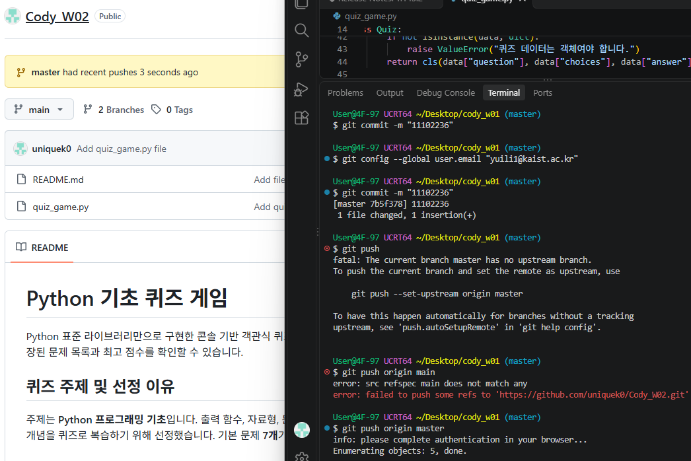
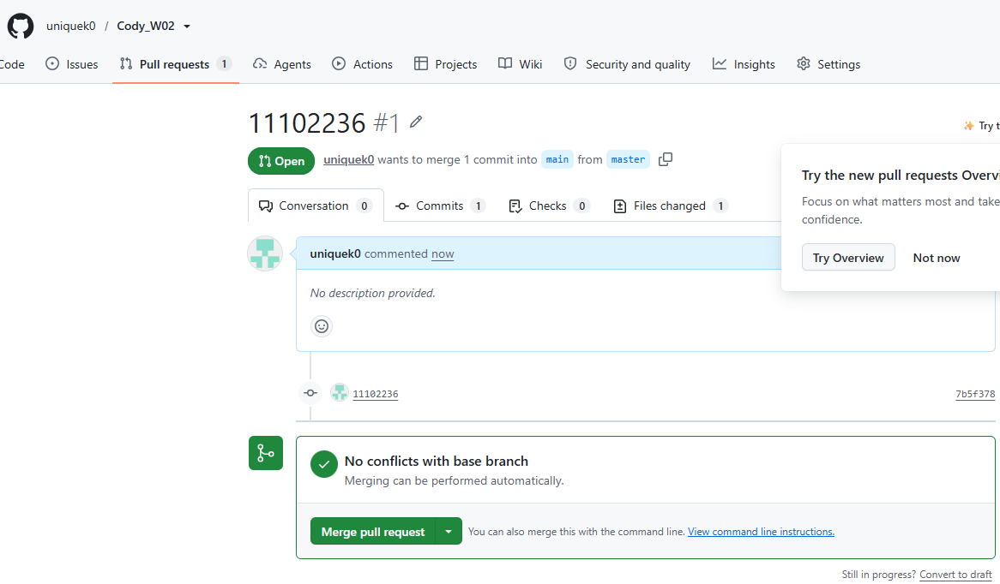
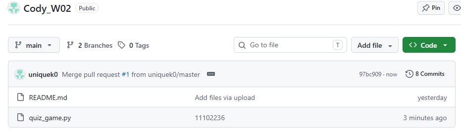

# Python 기초 퀴즈 게임

Python 표준 라이브러리만으로 구현한 콘솔 기반 객관식 퀴즈 프로그램입니다. 사용자는 퀴즈를 풀거나 새 문제를 등록하고, 저장된 문제 목록과 최고 점수를 확인할 수 있습니다.

## 퀴즈 주제 및 선정 이유

주제는 **Python 프로그래밍 기초**입니다. 출력 함수, 자료형, 문자열 길이, 주석, 연산자, 조건문, 반복문처럼 입문자가 자주 접하는 개념을 퀴즈로 복습하기 위해 선정했습니다. 기본 문제 **8개**가 제공되며 사용자가 문제를 추가할 수 있습니다.

## 실행 방법

1. Python 3.8 이상을 설치합니다.
2. 터미널에서 `quiz_game.py`가 있는 폴더로 이동합니다.
3. 다음 명령어로 실행합니다.

```bash
python quiz_game.py
```

환경에 따라 `python3 quiz_game.py`를 사용합니다. 별도의 패키지 설치는 필요하지 않습니다.

프로그램 실행 시 다음 메뉴가 나타납니다.

```text
========== Python 기초 퀴즈 ==========
1. 퀴즈 풀기
2. 퀴즈 추가
3. 퀴즈 목록
4. 최고 점수 확인
5. 종료
======================================
메뉴 선택 (1~5):
```

실행 결과 예시:

```text
메뉴 선택 (1~5): 4
[안내] 아직 퀴즈를 푼 기록이 없습니다.

========== Python 기초 퀴즈 ==========
1. 퀴즈 풀기
2. 퀴즈 추가
3. 퀴즈 목록
4. 최고 점수 확인
5. 종료
======================================
메뉴 선택 (1~5): 5
게임을 종료합니다.
```

## 기능 한눈에 보기

| 메뉴 | 기능 |
| --- | --- |
| 1. 퀴즈 풀기 | 저장된 모든 문제를 등록 순서대로 풀고, 문제별 정오답과 마지막에 총 정답 수 및 정답률을 확인합니다. |
| 2. 퀴즈 추가 | 문제, 선택지 4개, 정답 번호를 입력해 새 문제를 등록하고 즉시 저장합니다. |
| 3. 퀴즈 목록 | 등록된 문제, 선택지와 정답을 순서대로 확인합니다. |
| 4. 최고 점수 확인 | 최고 기록의 정답 수, 당시 문제 수 및 정답률을 확인합니다. |
| 5. 종료 | 종료 전에 데이터를 저장하고 프로그램을 끝냅니다. |

### 퀴즈 진행 및 점수

1. 메뉴에서 **1. 퀴즈 풀기**를 선택하면 현재 등록된 문제 수와 진행 순서를 표시합니다.
2. 각 문제의 선택지 네 개를 확인한 뒤 `1`부터 `4`까지 정답 번호를 입력합니다. 정답 여부를 바로 알려주며, 오답이면 올바른 정답 번호도 보여줍니다.
3. 모든 문제를 푼 뒤 `정답 수 / 전체 문제 수`와 백분율을 소수점 첫째 자리까지 표시합니다.
4. 최고 기록은 정답 **개수**가 이전 기록보다 클 때 갱신됩니다. 정답 개수가 같으면 갱신하지 않습니다. 기록에는 당시의 총 문제 수도 함께 저장하므로, 문제 추가 전후의 기록을 각각 그 당시 기준으로 표시합니다.
5. 퀴즈를 모두 완료하면 결과와 최고 기록을 저장합니다. 진행 중 프로그램이 중단되면 해당 판의 중간 점수는 저장되지 않습니다.

### 문제 추가 및 입력 검증

- 새 문제는 문제 문장, 1~4번 선택지, 정답 번호 순서로 입력합니다. 질문과 선택지는 앞뒤 공백을 제거한 뒤 저장합니다.
- 질문과 선택지는 빈 문자열일 수 없고, 선택지는 정확히 네 개여야 합니다. 정답은 `1`~`4` 사이의 정수여야 합니다.
- 메뉴와 정답 입력에서도 빈 값, 숫자가 아닌 값, 허용 범위를 벗어난 값은 오류를 안내한 뒤 다시 입력받습니다. 입력값이 유효하지 않아도 프로그램이 종료되지는 않습니다.
- 문제를 추가하면 현재 실행 중 문제 목록에 반영하고 바로 저장을 시도합니다. 저장에 실패하면 오류를 안내하며, 문제는 현재 실행 중에는 남아 있지만 재실행 후에도 유지된다고 보장할 수 없습니다.
- 등록된 문제가 없으면 퀴즈 풀기와 목록 보기에서 안내를 표시합니다. 직접 편집한 저장 파일에 빈 문제 목록이 있어도 빈 목록 그대로 실행됩니다.

### 저장 및 예외 상황

- 데이터는 `quiz_game.py`가 있는 디렉터리의 `state.json`에 저장됩니다. 별도 패키지 설치나 외부 서비스 연결은 필요하지 않습니다.
- 최초 실행 시 기본 문제 8개로 시작하고 상태 파일을 만듭니다. 이후 문제 추가, 퀴즈 완료, 정상 종료 또는 `Ctrl+C`/EOF 종료 시 저장을 시도합니다.
- 파일이 없거나 손상되면 안내 메시지를 출력하고 유효한 `.bak`을 복구에 사용합니다. 사용할 수 있는 백업이 없으면 기본 문제와 기록 없음 상태로 초기화합니다.
- 저장 오류와 백업 오류는 콘솔에 표시합니다. 저장할 수 없는 경우 변경사항이 파일에 기록되지 않을 수 있습니다.
- 동시 실행 잠금은 제공하지 않습니다. 같은 데이터를 여러 프로그램에서 동시에 수정하면 한쪽 변경이 다른 쪽 저장 내용으로 덮어써질 수 있습니다.

### 코드 구성

| 구성 요소 | 책임 |
| --- | --- |
| `Quiz` | 질문, 선택지 4개 및 정답을 검증하고 보관합니다. 문제 표시, 답 확인, JSON 변환을 제공합니다. |
| `default_quizzes()` | 프로그램 최초 실행이나 복구 시 사용하는 Python 기초 기본 문제 8개를 생성합니다. |
| `QuizGame` | 메뉴와 입력 처리, 퀴즈 진행·점수 계산, 저장·불러오기·백업 복구를 담당합니다. |
| `QuizGame.play()` | 문제를 순서대로 출제하고 답안을 채점한 뒤 결과와 최고 기록을 저장합니다. |
| `QuizGame.add_quiz()` | 사용자의 입력을 검증해 문제를 추가하고 파일 저장을 시도합니다. |
| `QuizGame.load()` / `save()` | 상태 파일을 검증해 읽고 저장하며, 손상된 상태에서 백업 복구를 처리합니다. |

`QuizGame.play()`는 각 `Quiz` 객체의 표시 및 답 확인 기능을 사용합니다. 문제 단위의 데이터와 동작은 `Quiz`에, 전체 게임 흐름과 저장 상태는 `QuizGame`에 두어 역할을 나눕니다.

### 입력 검증 점검 항목

자동화된 단위 테스트는 포함되어 있지 않습니다. 다음은 수동 실행 시 확인할 입력 검증 항목입니다.

| 확인 항목 | 입력 예시 | 기대 동작 |
| --- | --- | --- |
| 빈 입력 | Enter만 입력 | 빈 입력 오류를 표시하고 다시 입력받음 |
| 숫자가 아닌 입력 | `abc` | 숫자 입력 오류를 표시하고 다시 입력받음 |
| 허용 범위 밖의 숫자 | 메뉴에서 `0` 또는 `6` | 허용 범위를 안내하고 다시 입력받음 |
| 정상 숫자 | 메뉴에서 `1`~`5`, 정답에서 `1`~`4` | 해당 메뉴 또는 답안으로 처리 |
| 입력 스트림 종료 | `Ctrl+C` 또는 EOF | 안내 메시지를 출력하고 종료 과정에서 저장을 시도 |

### 실행 예시

다음은 한 문제에 정답을 입력했을 때의 출력 형태입니다. 실제 문제는 기본 문제 8개를 순서대로 모두 출제합니다.

```text
--- 1/8번 문제 ---
Python에서 화면에 내용을 출력하는 함수는?
  1. input()
  2. print()
  3. len()
  4. type()
정답 번호 (1~4): 2
정답입니다!
```

## 파일 구조

```text
quiz-project/
├── quiz_game.py      # Quiz, QuizGame 클래스 및 기본 퀴즈 데이터
├── README.md         # 프로젝트 설명서
├── git_pull_push.png # 커밋 및 푸시 화면
├── git_merge0.png    # Pull request 생성 화면
├── git_merge1.png    # 병합 후 저장소 화면
├── state.json        # 실행 시 자동 생성되는 퀴즈 및 최고 점수 데이터
└── state.json.bak    # 저장 시 자동 생성·갱신되는 백업 데이터
```

PNG 스크린샷은 저장소에 포함되어 있습니다. `state.json`과 `state.json.bak`은 실행 중 생성되는 개인별 데이터이며, 공유 저장소에 올리지 않도록 `.gitignore`에 추가하는 것을 권장합니다.

## 데이터 파일: `state.json`

- **경로:** 일반적인 `.py` 실행 시 `quiz_game.py`와 같은 폴더(프로젝트 루트)
- **인코딩:** UTF-8
- **역할:** 문제 목록과 최고 점수를 JSON 형식으로 보관
- **최초 실행:** 파일이 없으면 기본 문제 8개로 시작하며 새 파일을 생성
- **저장 시점:** 문제 추가 후, 퀴즈 완료 후, 프로그램 종료 시 저장을 시도합니다. 문제를 푸는 도중의 점수 체크포인트는 지원하지 않습니다.
- **백업:** 저장 시 기존 `state.json`이 유효하면 같은 폴더의 `state.json.bak`에 복사한 뒤 새 파일로 교체합니다. 유효한 상태가 처음 저장될 때도 `.bak`을 생성합니다.
- **손상된 파일:** 오류를 안내하고 `state.json.bak`의 데이터와 점수를 검증해 복원합니다. 백업이 없거나 손상된 경우에만 기본 문제 및 초기 점수로 초기화한 뒤 저장을 시도합니다.
- **읽기/쓰기 오류:** `QuizGame.load()`와 `QuizGame.save()`에서 예외를 처리해 안내 메시지를 출력합니다.

예시 스키마:

```json
{
  "quizzes": [
    {
      "question": "Python에서 화면에 내용을 출력하는 함수는?",
      "choices": ["input()", "print()", "len()", "type()"],
      "answer": 2
    }
  ],
  "best_score": null,
  "best_total": null
}
```

| 키 | 자료형 | 설명 |
| --- | --- | --- |
| `quizzes` | 배열 | 문제 객체 목록. 각 객체에는 `question`(문자열), `choices`(문자열 4개 배열), `answer`(1~4 정수)가 포함됩니다. |
| `best_score` | 정수 또는 `null` | 최고 정답 개수. 기록이 없으면 `null`입니다. |
| `best_total` | 정수 또는 `null` | 최고 기록을 세웠을 당시의 전체 문제 수입니다. |

**복구 및 운영 참고:** 프로그램이 손상 또는 누락된 `state.json`을 발견하면 유효한 `state.json.bak`을 자동으로 읽어 복원하고 현재 파일에 다시 저장합니다. 백업도 없거나 손상되어 있으면 기본 데이터로 초기화합니다. `.bak`에는 마지막으로 교체되기 전의 유효한 저장 내용이 남으므로, 예기치 않은 종료 시 가장 최근 저장 직전 상태로 복원될 수 있습니다. JSON은 파일 전체를 메모리에 읽고 저장할 때 전체 내용을 다시 쓰므로 현재처럼 작은 단일 사용자 데이터에 적합합니다. 데이터가 커지거나 여러 프로세스가 동시에 수정해야 하면 잠금과 트랜잭션을 제공하는 SQLite 같은 데이터베이스를 고려해야 합니다. 현재 파일 쓰기는 임시 파일 교체를 사용하지만 동시 실행 잠금은 제공하지 않아, 동시에 저장하면 마지막 저장이 앞선 변경을 덮어쓸 수 있습니다.

향후 태그나 난이도를 추가한다면 문제 객체에 선택 필드를 추가하고, 기존 `state.json`과 호환되도록 스키마 버전 및 변환 절차를 함께 설계할 수 있습니다.

## 코드 변경 위치

| 요구사항 변경 | 수정 위치 | 영향 범위 |
| --- | --- | --- |
| 문제 형식·기본 문제 | `Quiz`, `default_quizzes()` | 문제 생성과 초기 데이터 |
| 입력 규칙 | `QuizGame.read_number()`, `read_text()` | 메뉴, 정답 및 새 문제 입력 |
| 퀴즈 진행·점수 | `QuizGame.play()`, `show_best_score()` | 출제, 채점 및 최고 기록 |
| 저장 데이터 형식 | `Quiz.to_dict()`, `Quiz.from_dict()`, `QuizGame.load()`, `save()` | JSON 읽기·쓰기 및 호환성 |
| 메뉴와 화면 | `QuizGame.show_menu()`, `run()`, `list_quizzes()` | 사용자 흐름과 출력 |

## Git 실습

### 커밋 및 원격 저장소에 푸시

`master` 브랜치에서 변경사항을 커밋한 뒤 원격 저장소로 푸시했습니다.

```bash
git add quiz_game.py
git commit -m "11102236"
git push origin master
```

처음 `git push`를 실행했을 때는 upstream 브랜치가 설정되지 않아 실패했습니다. `git push origin main`도 로컬에 `main` 브랜치가 없어 실패했으며, 현재 브랜치 이름에 맞춘 `git push origin master`로 푸시했습니다.



커밋은 한 가지 논리적 변경 단위로 나누고, 메시지는 변경 내용을 간결한 동사형으로 작성하는 것을 권장합니다(예: `feat: 입력 검증 추가`, `docs: Git 실습 기록 보완`). 기존 실습 이력에는 과제 식별자 형태의 메시지도 포함되어 있습니다.

### Pull request로 `main`에 병합

GitHub에서 `master`의 커밋을 `main`에 병합하는 Pull request를 생성했습니다. 변경사항은 충돌 없이 자동 병합 가능한 상태였고, Pull request를 병합한 뒤 `main` 브랜치에 병합 커밋이 생성되었습니다.





이 실습에서 병합 방향은 **`master`에서 `main`으로**입니다. 이 프로그램 자체가 Git 명령을 자동으로 실행하지는 않습니다.

브랜치는 작업을 분리해 변경사항을 검토한 뒤 합치기 위해 사용합니다. 병합 전에는 대상 브랜치와 변경 파일을 확인하고, 실행 또는 입력 검증을 점검하며, 충돌이 있으면 해결한 뒤 다시 검토하는 것을 체크포인트로 삼습니다. 확인된 병합 커밋은 `97bc909`(PR #1), `7cd7f66`(PR #2)입니다.

전체 커밋 이력은 `git log --oneline --all`로 확인할 수 있습니다. 현재 저장소 이력은 11개 커밋이며, 아래는 확인된 출력입니다.

```text
6b8905a 문서에 Git 실습 내역 추가
7cd7f66 Merge pull request #2 from uniquek0/master
00a659d 11102242
97bc909 Merge pull request #1 from uniquek0/master
7b5f378 11102236
f14e817 Add quiz_game.py file
1ebe06d Add files via upload
94b5405 Enhance README with project details and instructions
897b7f1 Add basic quiz game implementation
d4da747 Update README to include quiz.py description
c697437 Initial commit
```
